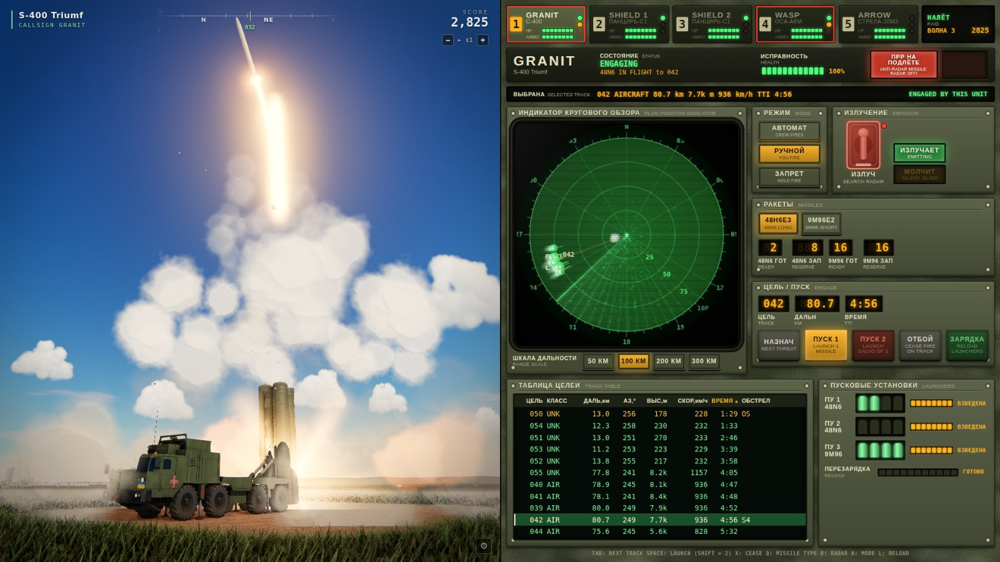

# Echelon: layered air defense



**You command an airfield's air defense, layer by layer: a modern airbase on the steppe in the 2020s, or the German flak at the Hopsten jet airfield in February and March 1945.**

**Why it's different:** every unit is a real system, true to its name, look and place in the layering, and the WW2 setting is researched from period sources. The mechanics are game rules tuned for play, not a weapons model.

## What you do

- **Modern era:** an S-400 battalion for the long range, two Pantsir-S1 for point defense, an Osa-AKM and a Strela-10M3 for short range, against seven raids of drones, cruise missiles, fighters, decoys, helicopters and ballistic missiles.
- **WW2 era:** an 8.8 cm battery, two 3.7 cm platoons, 2 cm Flakvierlinge and a what-if flak tower, against six day raids, from a Spitfire photo run to B-17 boxes dropping Window.
- **Two halves:** the selected unit in 3D on the left, its console on the right. Crews fight on their own in auto, but wastefully; in manual you give the orders.
- **Loadout:** pick a unit for each of five slots. Every modern slot has an alternative; in WW2 so far only slot 5.
- **Tutorials:** fourteen guided lessons on a quiet range, one per kind of unit plus the basics.

## Play it

```bash
npm install
npm run dev      # http://localhost:5200
```

You need Node.js, and a browser with WebGL2, a keyboard and a mouse.

To share it, serve the build (`dist/`) from any web server or folder, or zip it for itch.io. More in [Development](docs/DEVELOPMENT.md).

## Controls

| Key | Action |
|---|---|
| `1`-`5` | select a unit (or click its tab) |
| Drag, wheel | orbit and zoom the camera |
| Click a track | select it on a scope, plot or table |
| `Tab` | next track (WW2: next aircraft) |
| `Space` | launch a missile; hold to fire guns (WW2: FEUER) |
| `A` | mode: auto, manual, hold (WW2: FREI, BEFEHL, HALT) |
| `V` | padlock the camera on the selected track |
| `[` `]` | time compression, x0.25 to x8 |
| ⚙ (bottom right) | settings: quality, difficulty, weather and more |

All keys: [How to play](docs/PLAYING.md#controls).

## Status

Both eras play start to finish on three difficulties, with every loadout option and all fourteen lessons.

Not done yet:

- WW2 alternatives for slots 1 to 4 (planned; candidates in the local `refs/ww2/README.md`, section 3).
- A fresh side-by-side check of the other WW2 models against their reference photos (the flak towers and the 12.8 cm twin have had theirs).

## Go deeper

- [How to play](docs/PLAYING.md): modes, units, every key, the lessons.
- [What's modelled](docs/MODELLED.md): rendering, simulation, sound.
- [History and sources](docs/HISTORY.md): what is real, what is game.
- [Development](docs/DEVELOPMENT.md): sharing the build, dev pages, tools, source layout.
- [DESIGN.md](DESIGN.md): the module contracts and changelog.

## More games

- [Battle Stations](https://github.com/drichards188/battlestations): man the anti-aircraft guns of USS Alabama in the Pacific, 1944.
- [Drumfire](https://github.com/drichards188/drumfire): command heavy artillery, from Ypres in 1917 to the Gustav.

## Credits

- **Libraries:** [three.js](https://threejs.org) and [lil-gui](https://lil-gui.georgealways.com) (MIT); Vite (MIT) and playwright-core (Apache 2.0) for development.
- **Recordings:** eight from Freesound, seven of them CC0 ([list](public/audio/CREDITS.md)). ["Tykki, laukaus / Big gun, cannon, 76 mm, single shots, gunshots"](https://freesound.org/s/332935/) by YleArkisto is licensed under [CC BY 4.0](https://creativecommons.org/licenses/by/4.0/).
- **WW2 terrain:** heights from EU-DEM v1.1 (Copernicus Land Monitoring Service, funded by the European Union); waterways and villages © OpenStreetMap contributors (ODbL).

**License:** © 2026 David Richards. Echelon is source-available under [PolyForm Strict 1.0.0](LICENSE): you may play and study it for non-commercial purposes, but not copy, change or publish your own version of it, or use it commercially. Contributions are welcome here; see [Contributing](CONTRIBUTING.md). The libraries, recordings and data above keep their own licenses.
